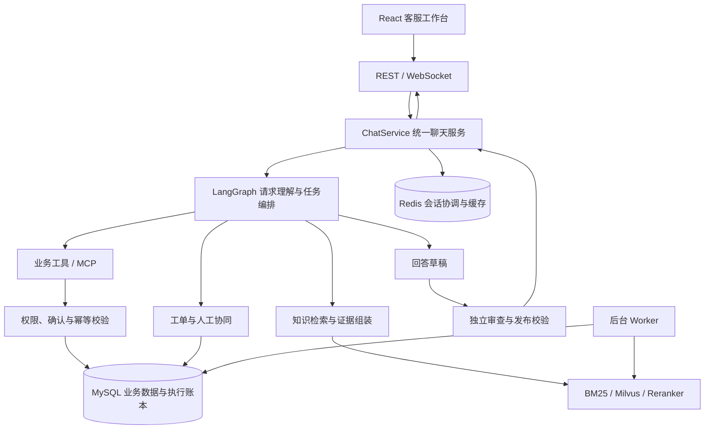

# AICSHub · 智能客服

**让客服对话连接知识、业务与人工协作。**

AICSHub 是基于 **FastAPI + LangGraph + React** 构建的智能客服系统，面向订单查询、售后咨询、知识问答和人工协同场景。项目将请求理解、混合检索、业务工具、独立回答审查与持久执行整合到同一条服务链路，让回答有来源、操作有约束、执行有记录。

[功能与场景](#功能与场景) · [系统架构](#系统架构) · [快速启动](#快速启动) · [本地开发](#本地开发) · [测试与验证](#测试与验证) · [文档导航](#文档导航)

> 退款能力覆盖模拟预览、申请与审核，不接入真实支付。任务循环、多意图处理及 Judge 协议由配置控制；仓库模板采用保守默认值，具体实例以有效配置和对应验收记录为准。

## 功能与场景

### 面向用户的服务

| 场景 | 示例诉求 | 处理方式 |
| --- | --- | --- |
| 订单与物流 | “帮我查一下这笔订单的物流。” | 校验身份与订单归属后查询业务数据，缺少必要信息时先补问 |
| 售后与政策 | “包装破损怎么办？退货有什么条件？” | 检索已发布知识，结合适用条件生成回答并核对来源 |
| 多项诉求 | “查一下订单，再告诉我退款规则。” | 启用逐项模式后分别处理、绑定证据并记录各项状态 |
| 模拟退款 | “我想申请退款。” | 检查资格与参数，生成预览；提交需要本轮明确确认 |
| 工单与人工 | “这个问题需要人工处理。” | 登记持久工单或人工请求，依据实际回执反馈进度 |
| 多轮沟通 | “订单号是……”“取消刚才的申请。” | 保留必要上下文与待办参数，每轮重新建立证据和执行状态 |

信息不足、等待补充或等待确认时，系统保留对应状态；安全回答可以是有依据的部分说明，不要求所有请求都被标记为完成。人工请求登记成功也不等于已经接通客服。

### 面向运营的工作台

前端提供聊天、会话历史、知识库、搜索、工单、人工协同、用户管理、数据分析与账号页面。管理类资源按服务端角色和资源归属授权，具体接口与权限见 [API 说明](docs/API.md)和[安全说明](docs/SECURITY.md)。

## 系统架构



该图展示主要职责关系，具体分支、降级路径和开关见 [Agent 链路](docs/AGENT_GRAPH.md)。

### 设计要点

- **统一业务入口**：REST 与 WebSocket 共用 `ChatService`，统一完成状态恢复、执行与落库，避免两套传输产生不同业务行为。
- **独立轮次状态**：每条消息通过 `AgentState.for_next_turn()` 开始新一轮，保留必要历史与未完成参数，重新获取本轮证据、工具结果和校验结果。
- **有界任务编排**：任务循环受决策次数、工具调用次数和时限约束；逐项模式分别记录诉求覆盖和阶段，区分已回答、缺信息与待确认。
- **先审查再发布**：供应商草稿在服务端缓冲，响应节点统一执行最终校验；独立 Judge 检查事实与证据，生成模型自检不替代独立检查。
- **知识版本一致性**：知识写入使用稳定文档 ID、版本条件更新和持久索引任务，索引验证后切换发布指针；检索与发布核对当前快照。
- **受保护的业务操作**：权限、参数、资格、幂等与确认由服务端业务层校验，模型输出和历史确认不能授权新的写操作。
- **执行可追踪**：SQL Run、任务与能力执行账本配合会话租约、版本条件写入及后台 Worker，记录受保护路径的执行与恢复信息。
- **缓存与调用治理**：回答缓存绑定用户、上下文、证据与模型策略，仅缓存通过校验且无业务副作用的回答；模型调用支持计量、预算与脱敏追踪。

## 技术栈

| 层次 | 技术与用途 |
| --- | --- |
| 前端 | React、TypeScript、Vite、Tailwind CSS；TanStack Query 与 Zustand 管理数据和交互状态 |
| API 与契约 | FastAPI、Pydantic；REST 与 WebSocket |
| Agent 编排 | LangGraph、LangChain Core、MCP |
| 业务持久化 | MySQL、SQLAlchemy、Alembic |
| 缓存与协调 | Redis；会话状态、缓存及模型准入协调 |
| 知识检索 | BM25、Milvus、独立 Embedding 与 Reranker 服务 |
| 模型接入 | OpenAI 兼容接口；聊天、向量与重排分别配置 |
| 运行与验证 | Docker Compose、pytest、Vitest；可选 Langfuse 与 OpenTelemetry |

## 快速启动

### 1. 准备环境

推荐通过 Docker Compose 启动完整服务，命令在项目根目录的 Windows PowerShell 中执行。

| 环境 | 用途 |
| --- | --- |
| Docker 与 Docker Compose | 运行 API、Worker 及数据库、缓存、检索依赖 |
| Windows PowerShell | 执行项目启动和维护脚本 |
| Python 3.11+ | 本地后端开发与隔离回归时需要 |
| Node.js 与 npm | 本地前端开发时需要；Docker 前端构建使用 Node.js 22 |
| NVIDIA GPU 与容器 GPU 支持 | 仅选择需要 GPU 的本地模型栈时准备 |

### 2. 创建本地配置

仅在 `.env` 不存在时复制模板，避免覆盖已有配置：

```powershell
if (-not (Test-Path .env)) { Copy-Item .env.example .env }
```

编辑本地 `.env`，优先完成以下配置。README 不保存真实凭据，密钥和私有连接信息仅保存在本地配置或密钥管理服务中。

| 配置组 | 需要确认的内容 |
| --- | --- |
| 数据与存储 | 替换 MySQL、MinIO 的占位密码，确认端口与存储安排 |
| 认证 | 设置随机且至少 32 字符的 `AUTH_SECRET_KEY`，按用途设置 CORS |
| 聊天模型 | 配置 `LLM_API_BASE`、`LLM_API_KEY`、`LLM_MODEL` 及供应商支持的协议 |
| 向量模型 | 配置 `EMBEDDING_API_BASE`、模型、维度和 revision，检查索引兼容性 |
| 重排模型 | 按需要配置外部 Reranker 或本地重排服务 |
| 功能开关 | 确认请求理解、任务循环、逐项完成检查及 Judge 契约的组合 |

`.env.example` 默认使用规则理解、关闭任务循环与逐项模式、保留 Judge v1。配置来源、Compose 映射和带日期的本机快照见[配置说明](docs/CONFIGURATION.md)。修改 `.env` 时还需核对 Compose 是否向容器传入对应字段。

聊天、Embedding、Reranker 独立配置。更换聊天模型不会同时更换向量模型；更换向量模型或维度，需要检查已有 Milvus collection 与索引。

### 3. 构建、迁移并启动

```powershell
.\scripts\start.ps1 -SkipSeed
```

脚本构建应用镜像，启动依赖，执行 Alembic 迁移，再启动 API 与常驻 Worker。Docker 构建包含前端构建，生成的静态资源由后端提供。

`-SkipSeed` 跳过演示订单和知识导入。首次启动后仍需按业务需要准备账号与知识；模板默认关闭演示账号初始化。演示数据导入属于独立的数据写入操作。

可选服务通过参数选择，并同步配置模型地址：

| 参数 | 用途 |
| --- | --- |
| `-LocalEmbedding` | 仅启动本地 Embedding |
| `-Reranker` | 启动本地重排模型 |
| `-LocalModels` | 同时启动本地 LLM 与 Embedding |
| `-Langfuse` | 启动可选观测栈 |
| `-All` | 启动全部可选栈，资源需求相应增加 |

例如，需要本地向量与重排服务时：

```powershell
.\scripts\start.ps1 -SkipSeed -LocalEmbedding -Reranker
```

模型服务启动与业务配置生效是两个步骤，模型是否真正参与检索应以实际请求与检索元数据核对。已有部署的升级和回滚请按[部署说明](docs/DEPLOYMENT.md)操作。

### 4. 检查服务

```powershell
docker compose ps
Invoke-RestMethod http://localhost:8100/health
```

| 入口 | 默认地址 |
| --- | --- |
| 应用首页 | `http://localhost:8100/` |
| 健康检查 | `http://localhost:8100/health` |
| 交互式 API 文档 | `http://localhost:8100/docs` |
| OpenAPI 契约 | `http://localhost:8100/openapi.json` |
| 前端开发服务器 | `http://localhost:5174/`，需单独启动 Vite |

端口以有效配置为准。服务健康只说明相应健康检查通过，完整业务流程还需要准备数据、核对模型接入并完成场景验证。

### 5. 日常启停

已有完整部署可以使用根目录的 `start.bat` / `stop.bat`，或双击运行。它们调用 `scripts/runtime.ps1`，复用已有主栈、Embedding 和 Reranker 容器，保留当前镜像与配置；不构建、不迁移、不导入数据，也不启动本地 Qwen LLM。

首次安装、缺少 API 或 Worker 容器时，使用前述 `scripts/start.ps1 -SkipSeed`。也可通过以下命令停止对应服务并保留数据卷：

```powershell
.\scripts\stop.ps1
```

`-Data`、`docker compose down -v` 和知识导入的 `--clear` 涉及数据清理，不用于日常停止或常规验证。

## 本地开发

### 后端

```powershell
python -m venv .venv
.\.venv\Scripts\Activate.ps1
pip install -r requirements.txt -c requirements.lock
```

本机运行后端前，将数据库、Redis 等依赖地址配置为宿主机可达地址。Compose 内部的 `mysql`、`redis`、`milvus` 服务名不能直接作为本机连接地址。

准备好依赖与迁移后启动开发服务：

```powershell
python -m uvicorn app.main:app --host 127.0.0.1 --port 8100 --reload
```

SQLite 兼容路径与隔离回归需要额外安装 `aiosqlite`：

```powershell
pip install aiosqlite
```

### 前端

在另一个终端进入前端目录：

```powershell
cd frontend
npm ci
npm run dev
```

Vite 默认使用 `5174` 端口，将 `/api`（包含 WebSocket）和 `/health` 代理至本机 `8100`。变更后端端口时同步更新 `frontend/vite.config.ts`。生产构建输出至根目录 `static/`。

## 测试与验证

### 后端隔离回归

从根目录运行：

```powershell
python -m compileall app scripts
python scripts/test_offline.py
```

默认隔离入口使用临时运行目录、独立 SQLite 和外部依赖替身，并阻断网络连接，不读取项目业务 `.env`。测试输出、配置与源码指纹保存在 `reports/offline/`。

启用配置链路的隔离回归，以及按范围运行的示例：

```powershell
python scripts/test_offline.py --profile active
python scripts/test_offline.py --profile active tests/test_chat_turns.py
python scripts/test_offline.py tests/test_llm_provider_config.py
```

`active` 是显式定义的隔离测试配置，不代表复制线上实例的全部配置。直接执行 `python -m pytest` 受测试入口保护，使用上述脚本传递测试选择和 pytest 参数。

### 前端验证

在 `frontend/` 中运行：

```powershell
npm test
npm run build
```

前端构建包含 TypeScript 类型检查。未发现测试用例、用例失败或网络阻断尝试都需要如实记录，不能当作通过证据。

### 验证结果的适用范围

| 证据类型 | 能说明什么 |
| --- | --- |
| 配置与健康检查 | 配置是否生效、服务是否通过对应健康检查 |
| 隔离回归与 SDK 替身 | 受测代码在固定输入和模拟依赖下的行为 |
| 真实检索或模型调用 | 指定模型、知识快照和输入下的实际结果 |
| 部署与完整场景验收 | 对应镜像、配置和流程范围内的端到端表现 |

版本化报告记录各阶段的输入、失败、修复与未验证范围。历史通过结果不自动覆盖新源码、模型变更或生产容量；真实供应商评测遵循对应固定方案和授权额度。

## 项目结构

```text
.
├── app/
│   ├── agent/          LangGraph 编排、轮次状态、节点、工具与审查
│   ├── config/         应用配置与校验
│   ├── routers/        REST / WebSocket 传输与接口
│   ├── services/       聊天、模型网关、知识库与业务服务
│   ├── models/         持久化模型
│   ├── repositories/   数据访问
│   └── schemas/        Pydantic 契约
├── frontend/           React 工作台与前端测试
├── alembic/            数据库迁移
├── tests/              Python 回归测试
├── scripts/            启动、维护、导入与评测工具
├── 文档/               业务知识原文
├── docs/               架构、接口、操作与验收说明
├── acceptance/         固定场景、输入版本与标签
├── reports/            本地运行证据与派发账本（Git 忽略）
├── static/             前端构建输出
├── docker-compose.yml  主栈与可选服务编排
└── .env.example        无密钥配置模板
```

`文档/` 与 `docs/` 用途不同：前者保存业务知识来源，后者保存工程说明。固定输入、来源身份、派发账本和历史回执需要保持可追溯，目录索引本身不代表验收结论。

## 常见问题

| 问题 | 优先检查 |
| --- | --- |
| 修改 `.env` 后容器行为没有变化 | 核对 Compose 映射、容器是否已按新配置创建，以及容器内有效值 |
| 前端开发页无法访问 API | 核对后端 `8100`、Vite 代理和浏览器请求；WebSocket 使用同一代理入口 |
| 知识问答没有召回或发生降级 | 检查知识发布状态、索引任务、Embedding 指纹与维度，以及模型服务可达性 |
| 启动后无法登录 | 模板默认关闭演示账号；按安全说明准备账号，核对数据库迁移和认证配置 |
| 模型服务已启动但没有参与业务 | 检查业务使用的服务地址、模型名称和检索元数据，区分宿主机与容器网络 |
| 回答处于等待补充或等待确认 | 查看缺少的订单、条件或确认参数；对应事项可能仍未完成 |
| 测试被入口保护阻止 | 使用 `scripts/test_offline.py` 执行隔离回归 |

## 文档导航

| 想了解的内容 | 推荐入口 |
| --- | --- |
| Agent 节点、路由、轮次与工具链路 | [Agent 架构](docs/AGENT_GRAPH.md) |
| 接口与数据契约 | [API 说明](docs/API.md) |
| 配置来源、默认值与实例快照 | [配置说明](docs/CONFIGURATION.md) |
| 安装、升级、服务管理与回滚 | [部署说明](docs/DEPLOYMENT.md) |
| 身份、权限、隐私与副作用边界 | [安全说明](docs/SECURITY.md) |
| 模型调用、计量与预算治理 | [LLM 治理](docs/llm-governance.md) |
| 知识组织与检索机制 | [RAG 结构](docs/RAG-STRUCTURE-v2.md) |
| 多意图评价口径与场景边界 | [多意图评测标准 v2](docs/MULTI-INTENT-ORACLE-V2-ACCEPTANCE-20261108.md) |
| 全部文档与历史阶段记录 | [文档分类](docs/README.md) |
| 工具用途与执行约束 | [脚本导航](scripts/README.md) |
| 固定验收输入与材料 | [验收材料](acceptance/README.md) |
| 项目协作与修改规范 | [AGENTS.md](AGENTS.md) |
