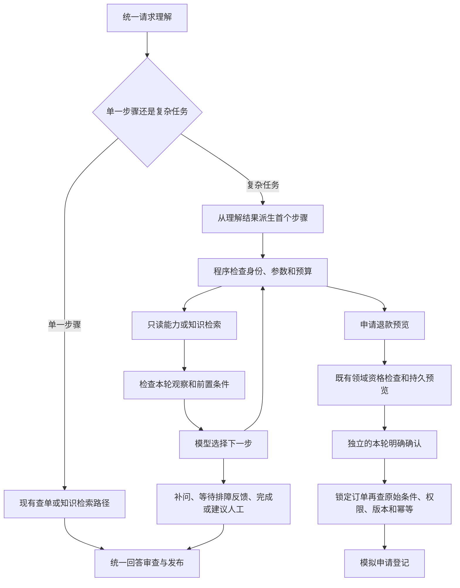

# Agent决策与调度：有限任务循环 v1

日期：2026-11-07。实现范围是任务状态、下一步决策、观察结果回流，及既有退款预览/确认流程接续。阶段验收见[验收记录](AGENT-TASK-LOOP-ACCEPTANCE-v1.md)。

## 当前状态

新增代码已接入同一张LangGraph及REST/WS共享Run执行器。任务循环独立配置`AGENT_TASK_LOOP_ENABLED=false`，本阶段未修改业务`.env`、未启用新循环、未执行真实模型调用。原先已启用的model请求理解是另一项已验范围，不能作为新决策循环的真实质量证据。

## 执行链路



首个确定能力复用统一理解，不额外调用一次规划模型。复杂任务在工具返回后才请求下一步决策。明确寒暄、已有动作的确认/取消仍先走确定事件；确认不重新规划或重新准备动作。

## 任务与轮次

`TaskProgress`是目标及恢复提示：任务ID、可信用户/操作人/会话、目标、类型、状态、所选订单/产品、原始条件、是否请求退款、待补项、停止原因及待确认动作ID。原始条件描述用户目标，不表示条件已经满足。

`TaskRuntime`仅属于当前轮次：输入范围、理解/参数/目标指纹、当前计划、调用次数、截止时间、已调用输入hash和步骤记录。`for_next_turn()`清空它，同时清空旧证据、工具结果、生成和确认。仅等待补充或等待确认的进度可继续携带，SQL恢复是权威来源。

持久化使用`agent_tasks`和`agent_task_steps`，关联现有会话及ChatRun。任务更新使用版本CAS，并与最终聊天结果在原会话租约/fence保护下同事务提交。步骤表保留能力、动作、执行状态、输入hash及错误码，不保存可当成新轮次证据的旧工具内容。

等待任务最多按24小时窗口恢复。用户独立提问时，旧任务关联停止；不能用旧目标选择无关订单。补原因或明确承接时，模型不能省略原任务的条件。任务记录不是新授权，也不能驱动恢复器重做写操作。

## 决策契约与能力边界

| 动作 | 模型可提出的内容 | 服务端约束 |
| --- | --- | --- |
| read | query_order/get_user_history，最多2项 | 订单必须是当前已理解对象；历史查询必须原请求已明确选择；身份由服务端注入 |
| search_knowledge | request/refund_policy/troubleshooting检索侧重点 | 服务端构造查询，走现有发布版本快照及检索证据契约 |
| ask_user | 订单、原因、产品、需求、排障反馈 | 业务补问采用固定通知；排障步骤仍由回答生成及独立审查处理 |
| prepare_refund | 请求生成预览 | 必须有本轮退款意向、完整参数、当前订单、满足的条件和当前政策证据 |
| finish | 请求结束并回答 | 不接受模型直接生成的最终正文；关联咨询缺知识时不可提前finish |
| suggest_handoff | 建议人工 | 不创建工单或人工请求，用户须明确另行发起 |

模型不能输出SQL、代码、用户身份、权限令牌、动作ID或直接提交退款。非法输出、能力失败、条件不满足、超时均安全停止；不退回旧分类器执行写操作。并行读取任一项失败都不能被最后一个成功结果覆盖。

单个任务默认每轮最多3次下一步模型决策、4次能力调用，调度阶段20秒；单次决策输出256 tokens。同轮相同参数的能力不重复执行。理解和任务决策采用单供应商单次尝试，不做语义修复/备用Provider重发。启用任务循环要求model模式及SQL模型网关；整Run仍受既有网关最多6次模型尝试、费用、token和Run总时限约束，最终生成/Judge同样消耗该预算。3次决策不是额外赠送6次模型额度。

## 退款接续

条件满足后可以请求预览，但申请不会自动提交。预览复用`RefundActionCoordinator`，继续使用原退款资格、全额限制、参数补齐标准和持久回执。原始条件另外存入`refund_actions.preconditions`，预览展示条件；提交时在锁定订单的同一事务重新检查，防止“预览时已签收、确认前变回已发货”仍提交。

当前业务退款资格仍按原领域规则判断。例如当前服务不支持未发货状态申请，模型不能因为用户提出“没发货就退”而改写资格。退款是模拟申请，不包含真实支付、自动审核或自动到账。

提交结果未知时沿用原Run/动作回执查询或对账；不重新规划提交。任务只跟随领域动作的submitted/cancelled等SQL状态更新，不以模型自述或另一笔动作的成功判断完成。

## 回答与可观察性

所有结束路径继续走统一回答构建、审查、发布组件。固定流程通知绑定本轮文本，模型生成的排障步骤或汇总不能借补问标志免除审查。审查失败任务标stopped，不自动创建人工请求。任务答复不读写普通回答缓存。

已有节点事件增加`task_decision`、`task_execution`、`task_observation`；Trace记录任务ID、状态、当前动作、次数及停止原因，不记录模型隐藏推理。REST结果和持久done事件增加可选`task_id/task_status`。`GET /api/v1/chat/tasks/{task_id}`返回经归属验证的进度与最近30条能力审计，不返回原始工具内容或凭据。

## 配置、迁移与启用

数据库迁移：`0012_agent_tasks`，父版本`0011_m4_model_revision`，增量添加任务表及退款动作条件列，不清空历史数据；已按当前metadata初始化的空库也可运行。禁止自动有损降级，回退通过关闭任务开关完成。

```dotenv
AGENT_TASK_LOOP_ENABLED=false
AGENT_TASK_REFUND_PREVIEW_ENABLED=false
AGENT_TASK_MAX_DECISIONS=3
AGENT_TASK_MAX_TOOL_CALLS=4
AGENT_TASK_TIMEOUT_SECONDS=20
AGENT_TASK_MAX_OUTPUT_TOKENS=256
```

启用前先备份数据库、运行迁移，再用冻结源码和新授权的受控真实模型请求验收三条场景：关联查询、排障反馈、条件售后。还需测试真实延迟、token/费用预算、Provider失效及跨轮任务成功率。本轮只完成离线实现验证，不能复用旧370/372账本剩余的startup槽位开展新任务质量批次。

本阶段没有独立Worker接管执行中的任意任务，没有承诺进程崩溃后从某次工具调用自动续跑。已提交Run回执沿用原恢复规则；可恢复的目标和待补项在下一个新Run中重新取得证据。新的前端任务面板也不在本阶段范围。

## 2026-11-07 启用前收口追加

- 新增`AGENT_TASK_REFUND_PREVIEW_ENABLED=false`：新任务循环的退款预览单独准入。即使订单、原因、政策和条件齐全，关闭时模型也不能派发`prepare_refund`。既有单一退款业务入口的确认/权限契约保持原逻辑，不能把此开关描述成整个系统的退款总开关。
- 混合任务只有本轮知识证据还不足以完成。原请求包含订单查询或已登记只读计划时，必须取得对应的成功观察，才能选择`finish`；两种诉求顺序都有实际LangGraph回归。
- 旧批处理测试显式固定400字符、50字符重叠和20条Embedding批量，不再依赖已改成500字符的分块默认值。新增1/20/21块边界覆盖，生产分块默认值未修改。
- 固定真实验收材料：`acceptance/agent-task-loop/scenarios-v1.json`，12个任务20轮，三类各4任务。2026-11-07用户明确选择新增最多120次HTTP请求。新账本独立于旧M4/M5/理解阶段账本，失败/未知结果不退额度。
- `scripts/prepare_agent_task_acceptance.py`冻结来源、方案、非敏感供应商配置及旧账本指纹；`scripts/evaluate_agent_task_acceptance.py`先演练SDK协议，再按独立授权执行。实际链路为隔离ASGI/SQLite/词法知识库与模型，不能冒充业务MySQL/Redis/向量模型、浏览器或生产并发的整体验收。
- MySQL迁移另外使用无发布端口、无业务卷的临时MySQL容器演练，旧0011合成回执保留、升0012及重复升级通过。候选镜像与工作区189份Python输入核对零差异，两个任务开关默认关闭。最终回归/真实验收状态见`AGENT-TASK-LOOP-READINESS-v2.md`。
